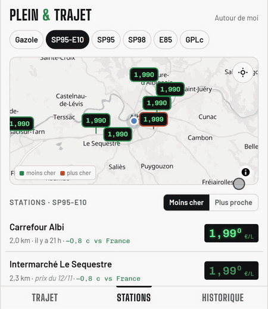

[English](README.md) · **Français**

# Plein & Trajet

**Les prix officiels des carburants autour de vous, et ce que chaque trajet a coûté en carburant, calculé d'après votre voiture et votre conduite.**

*L'appli en ligne, avec un tracé GPS Albi → Toulouse rejoué dans le navigateur. [Vidéo complète (1:21)](https://drive.google.com/file/d/1jcwdR7MaJ6Lg29hxW9j394Rkp16EhwIH/view)*

## Ce qu'on fait avec

- **Stations.** Carte et liste des stations autour de vous pour six carburants, la moins chère ou la plus proche d'abord. Chaque prix indique son âge et son écart à la moyenne nationale ; la fiche d'une station donne tous ses carburants.
- **Votre voiture.** Le code D.2 de la carte grise suffit : l'appli trouve ses versions dans le registre européen des voitures neuves (EEA) et garde masse, puissance et consommation officielle.
- **En route.** *Démarrer* enregistre le tracé GPS ; vitesse, kilomètres, litres et euros s'affichent en direct. Les litres viennent de la consommation officielle de la voiture pour chaque plage de vitesse, plus chaque accélération.
- **À l'arrivée.** Coût, litres, L/100 km, courbes de vitesse et de consommation, partage entre passagers. Le prix est la moyenne nationale du jour, celui d'une station ou le vôtre. Une voiture garée 10 minutes arrête le trajet, après confirmation.
- **Historique.** Trajets par mois avec totaux, gardés sur le téléphone ; aucun compte.
- **Android.** La même appli, avec un service de premier plan qui continue d'enregistrer écran éteint, derrière un GPS ou après qu'Android a tué l'appli.

## Architecture

## Déploiement

- **Web.** [plein-et-trajet.vercel.app](https://plein-et-trajet.vercel.app) ; prix français relevés toutes les 10 minutes, dix autres pays plusieurs fois par jour.
- **Android.** [APK 1.2.1](https://projets.ingevision.cloud/plein-et-trajet/plein-et-trajet.apk) (24 octobre 2026), hors Play Store. Enregistrement testé sur émulateurs Android 16 et 14 : appli tuée, restrictions de batterie, mise en veille, GPS perdu, redémarrage.
- **Technique.** React 18, TypeScript, Vite, MapLibre GL ; Capacitor avec un service Java ; Supabase (PostgreSQL, fonctions Deno, pg_cron) ; Vercel.

L'installer chez soi

Prérequis : Node.js 20 ou plus et un projet [Supabase](https://supabase.com) (l'offre gratuite suffit).

1. `npm ci`, puis `cp .env.example .env.local` et renseigner `VITE_SUPABASE_URL` et `VITE_SUPABASE_ANON_KEY`.
2. Base : remplacer `VOTRE-REF-PROJET` par la référence de votre projet dans `supabase/migrations/*.sql`, puis appliquer les migrations dans l'ordre (`supabase db push`).
3. Fonctions : `supabase functions deploy <nom>`, puis `supabase secrets set SYNC_SECRET=...` et le même secret dans Vault sous le nom `sync_prix_secret` ; le relevé des prix tourne alors tout seul.
4. `npm run dev`, ou `npm run build` pour `dist/` chez n'importe quel hébergeur statique (`vercel.json` pose les en-têtes de sécurité).
5. En option : `api/` sur Vercel pour les relais espagnol et roumain (`RELAIS_BASE_URL`) ; `scripts/build-apk.sh` pour Android (JDK 21, SDK Android, votre propre magasin de clés ; changer d'abord l'identifiant `org.example.pleinettrajet`).

`npm test` lance les tests unitaires (Vitest) ; certains appellent le géocodeur public de l'IGN. Sources de données et conditions : [`docs/SOURCES-DONNEES.md`](docs/SOURCES-DONNEES.md).

Code sous licence Apache 2.0 (`LICENSE`, `NOTICE`) ; textes et documentation sous CC BY 4.0 (`LICENSE-docs`).

---

**Anthony Hunt** · [ingevision.cloud](https://ingevision.cloud/?p=plein-et-trajet) · [LinkedIn](https://www.linkedin.com/in/anthony-hunt-3948a9196) · [GitHub](https://github.com/anthohunt)
