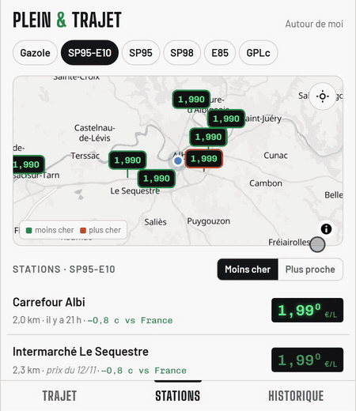

**English** · [Français](README.fr.md)

# Plein & Trajet

**Official fuel prices around you, and what each trip cost in fuel, worked out from your car and the way you drove.**

*The live app, with a GPS track from Albi to Toulouse replayed in the browser. [Full video (1:21)](https://drive.google.com/file/d/1jcwdR7MaJ6Lg29hxW9j394Rkp16EhwIH/view)*

## Using it

- **Stations.** Map and list of the stations around you for six fuels, cheapest or nearest first. Each price shows its age and its gap to the national average; a station's card lists all its fuels.
- **Your car.** Type the D.2 code from the registration certificate: the app finds its versions in the European register of new cars (EEA) and keeps mass, power and official consumption.
- **On the road.** *Démarrer* records the GPS track; speed, kilometres, litres and euros update live. Litres come from the car's official consumption for each speed range, plus every acceleration.
- **On arrival.** Cost, litres, L/100 km, speed and consumption curves, split between passengers. The price is the day's national average, a station's price or your own. A car parked for 10 minutes stops the trip, after confirmation.
- **History.** Trips by month with totals, kept on the phone; no account.
- **Android.** The same app with a foreground service that keeps recording with the screen off, behind a navigation app, or after Android kills the app.

## Architecture

## Deployment

- **Web.** [plein-et-trajet.vercel.app](https://plein-et-trajet.vercel.app); French prices refreshed every 10 minutes, ten other countries several times a day.
- **Android.** [APK 1.2.1](https://projets.ingevision.cloud/plein-et-trajet/plein-et-trajet.apk) (24 October 2026), outside the Play Store. Recording tested on Android 16 and 14 emulators: app killed, battery restrictions, Doze, GPS lost, reboot.
- **Stack.** React 18, TypeScript, Vite, MapLibre GL; Capacitor with a Java service; Supabase (PostgreSQL, Deno functions, pg_cron); Vercel.

Run it yourself

Requirements: Node.js 20 or later and a [Supabase](https://supabase.com) project (the free tier is enough).

1. `npm ci`, then `cp .env.example .env.local` and fill in `VITE_SUPABASE_URL` and `VITE_SUPABASE_ANON_KEY`.
2. Database: replace `VOTRE-REF-PROJET` with your project reference in `supabase/migrations/*.sql`, then apply the migrations in order (`supabase db push`).
3. Functions: `supabase functions deploy <name>`, then `supabase secrets set SYNC_SECRET=...` and the same secret in Vault as `sync_prix_secret`; the price sync then runs on its own.
4. `npm run dev`, or `npm run build` for `dist/` on any static host (`vercel.json` sets the security headers).
5. Optional: `api/` on Vercel for the Spanish and Romanian relays (`RELAIS_BASE_URL`); `scripts/build-apk.sh` for Android (JDK 21, Android SDK, your own keystore; change the `org.example.pleinettrajet` identifier first).

`npm test` runs the unit tests (Vitest); some call IGN's public geocoder. Data sources and their terms: [`docs/SOURCES-DONNEES.md`](docs/SOURCES-DONNEES.md) (in French). The interface is in French.

Code under Apache 2.0 (`LICENSE`, `NOTICE`); text and documentation under CC BY 4.0 (`LICENSE-docs`).

---

**Anthony Hunt** · [ingevision.cloud](https://ingevision.cloud/?lang=en&p=plein-et-trajet) · [LinkedIn](https://www.linkedin.com/in/anthony-hunt-3948a9196) · [GitHub](https://github.com/anthohunt)
