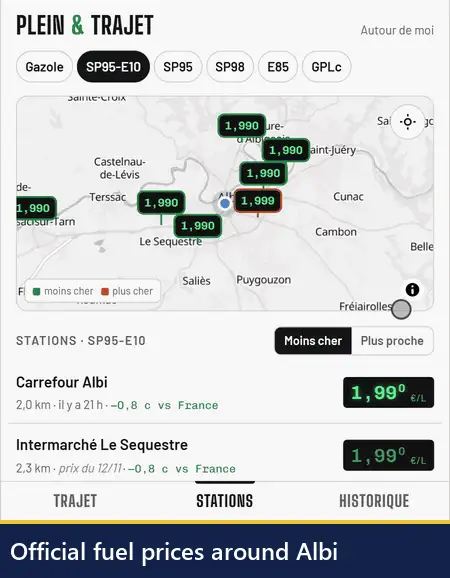
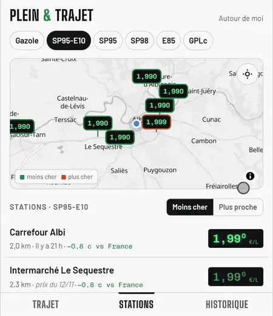

**English** · [Français](README.fr.md)

# Plein & Trajet

**Official fuel prices nearby, and the fuel cost of each trip, from your car and your driving.**

French version

*The live app, with a GPS track from Albi to Toulouse replayed in the browser.*

## Using it

- **Stations.** Map and list of the stations around you for six fuels, cheapest or nearest first. Each price shows its age and its gap to the national average; a station's card lists all its fuels.
- **Your car.** Type the D.2 code from the registration certificate: the app finds its versions in the European register of new cars (EEA) and keeps mass, power and official consumption.
- **On the road.** *Démarrer* records the GPS track; speed, kilometres, litres and euros update live. Litres come from the car's official consumption, spread over four speed ranges, plus the energy of each acceleration and climb. After 10 minutes without moving, the trip stops counting and asks whether it is over.
- **On arrival.** Cost, litres, L/100 km, speed and consumption curves, split between passengers. The price is the day's national average, a station's price or your own.
- **History.** Trips by month with totals, kept on the phone; no account.
- **Android.** The same app; it keeps recording, with a notification, screen off, behind Waze or Maps, or after Android kills it.

## Architecture

French version

## Deployment

- **Web.** [plein-et-trajet.vercel.app](https://plein-et-trajet.vercel.app); French prices refreshed every 10 minutes, ten other countries several times a day.
- **Android.** [APK 1.2.1](https://projets.ingevision.cloud/plein-et-trajet/plein-et-trajet.apk) (24 October 2026), outside the Play Store. Recording tested by the author on Android 16 and 14 emulators: app killed, battery restrictions, sleep mode, GPS lost, reboot. The app sends a technical log to the database when it opens and at each trip end.
- **Car lookup.** Down for codes not looked up before: the EEA register refuses the server's requests (seen on 17 November 2026).
- **Stack.** React 18, TypeScript, Vite, MapLibre GL; Capacitor with a Java service; Supabase (PostgreSQL, Deno functions, pg_cron); Vercel.

Run it yourself

Requirements: Node.js 20 or later and a [Supabase](https://supabase.com) project (the free tier is enough).

1. `npm ci`, then `cp .env.example .env.local` and fill in `VITE_SUPABASE_URL` and `VITE_SUPABASE_ANON_KEY`.
2. Database: replace `VOTRE-REF-PROJET` with your project reference in `supabase/migrations/*.sql`, then apply the migrations in order (`supabase db push`).
3. Functions: `supabase functions deploy <name>`, then `supabase secrets set SYNC_SECRET=...` and the same secret in Vault as `sync_prix_secret`; the price sync then runs on its own.
4. `npm run dev`, or `npm run build` for `dist/` on any static host (`vercel.json` sets the security headers).
5. Optional: `api/` on Vercel for the Spanish and Romanian relays (`RELAIS_BASE_URL`); `scripts/build-apk.sh` for Android (JDK 21, Android SDK, your own keystore; change the `org.example.pleinettrajet` identifier first).

`npm test` runs the 283 unit tests (Vitest); some call IGN's public geocoder. Data sources and their terms: [`docs/SOURCES-DONNEES.md`](docs/SOURCES-DONNEES.md) (in French). The interface is in French.

Code under Apache 2.0 (`LICENSE`, `NOTICE`); text and documentation under CC BY 4.0 (`LICENSE-docs`).

---

**Anthony Hunt** · [ingevision.cloud](https://ingevision.cloud/?lang=en&p=plein-et-trajet) · [LinkedIn](https://www.linkedin.com/in/anthony-hunt-3948a9196) · [GitHub](https://github.com/anthohunt)
